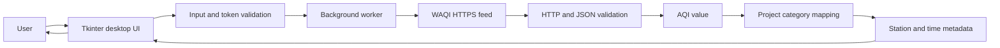
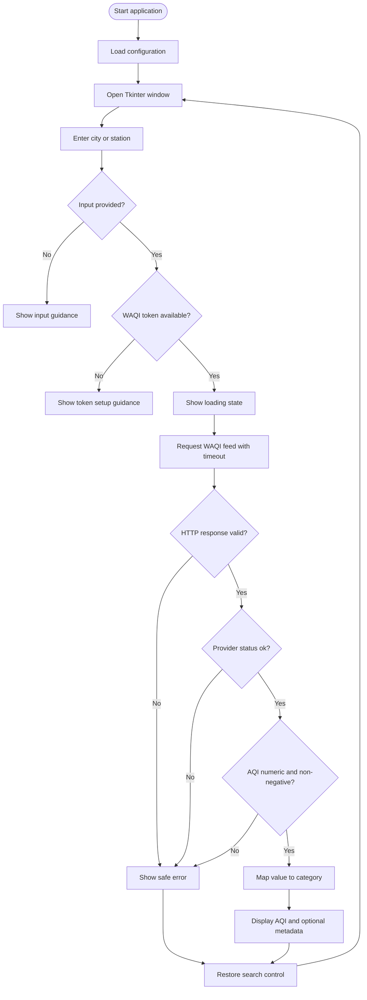

<div align="center">

# 🌍 AQI Finder Using Python

### A lightweight desktop application for on-demand Air Quality Index lookups

[](https://www.python.org/)
[](https://docs.python.org/3/library/tkinter.html)
[](https://aqicn.org/api/)
[](LICENSE)
[](https://github.com/Brajesh31/AQI-Finder-Using-Python/issues)

</div>

---

## 📌 Table of contents

- [🌱 Overview](#-overview)
- [🎯 Problem and objectives](#-problem-and-objectives)
- [✨ Current functionality](#-current-functionality)
- [🧱 Architecture](#-architecture)
- [🔁 Application workflow](#-application-workflow)
- [📊 AQI classification](#-aqi-classification)
- [🧰 Technology stack](#-technology-stack)
- [🚀 Installation](#-installation)
- [🔐 API configuration](#-api-configuration)
- [▶️ Run the application](#️-run-the-application)
- [🧪 Testing](#-testing)
- [⚠️ Limitations and responsible use](#️-limitations-and-responsible-use)
- [🗺️ Roadmap](#️-roadmap)
- [📚 Documentation](#-documentation)
- [🤝 Contributing](#-contributing)

## 🌱 Overview

AQI Finder Using Python is a desktop application that lets a user enter a city or supported monitoring-station query and request an air-quality reading from the World Air Quality Index (WAQI) feed. The application presents the returned AQI value with a category label and, when present in the provider response, station and observation-time metadata.

The project is intentionally small. Its current product boundary is a local Tkinter application that performs an on-demand API lookup. It is not a pollution sensor, forecasting model, medical assessment tool, multi-user web service, or official public-warning system.

## 🎯 Problem and objectives

Air-quality information is distributed across monitoring stations and provider interfaces. A lightweight desktop interface can make a location lookup more accessible without requiring a browser-based application.

The project aims to:
1. provide a simple input flow for a city or station query;
2. retrieve an AQI value from a documented external data source;
3. validate provider responses before presenting data;
4. keep the interface responsive while network activity is in progress;
5. show the returned value with a clearly labelled project category;
6. communicate source and observation context when available;
7. avoid storing search history or precise user location by default.

## ✨ Current functionality

| Capability | Current status | Behaviour |
|---|---|---|
| Desktop interface | Implemented | Tkinter window with location input and result/status areas |
| WAQI feed request | Implemented | HTTPS request using a configured token |
| Credential configuration | Implemented | Reads `WAQI_TOKEN` from process environment |
| Request timeout | Implemented | Finite timeout for provider requests |
| Response validation | Implemented | Checks HTTP status, JSON shape, provider status, and AQI value |
| Non-blocking lookup | Implemented | Network request runs outside the Tkinter event loop |
| AQI category mapping | Implemented | Six categories retained from the original prototype |
| Station and timestamp context | Conditional | Shown only when provider response contains these fields |
| Database / search history | Not implemented | No local or remote persistence |
| Forecasting and alerts | Not implemented | No prediction or scheduled notification system |
| Automatic geolocation | Not implemented | User enters the location manually |
| Web dashboard / backend | Not implemented | Product is a local desktop application |

## 🧱 Architecture



**Core design rules**

- Tkinter widgets are updated only on the main UI thread.
- Network requests have a finite timeout.
- Provider responses are validated before nested values are read.
- Missing metadata remains missing, it is not invented.
- Credentials are loaded from the environment, not embedded in Python source.
- User searches are not persisted.

See [Architecture](docs/architecture.md) and [API integration](docs/api.md).

## 🔁 Application workflow



This diagram describes the current application's intended control flow. Provider-specific details are documented separately.

## 📊 AQI classification

The application preserves the threshold mapping from the original prototype:

| AQI range | Project label |
|---:|---|
| 0–50 | 🟢 Good |
| 51–100 | 🟡 Moderate |
| 101–150 | 🟠 Unhealthy for Sensitive Groups |
| 151–200 | 🔴 Unhealthy |
| 201–300 | 🟣 Very Unhealthy |
| Above 300 | ⚫ Hazardous |

**Important:** AQI breakpoints, pollutant coverage, averaging periods, and health categories differ across national and regional standards. These are the categories configured by this project. They must not be treated as a universal regulatory AQI method. Read [AQI methodology](docs/aqi-methodology.md).

## 🧰 Technology stack

| Technology | Role |
|---|---|
| Python | Application language |
| Tkinter / ttk | Native desktop interface |
| Requests | HTTPS API communication |
| WAQI feed | External air-quality data provider |
| python-dotenv | Optional local environment-file helper for future use, not required by the current source |
| pytest | Automated test framework in development dependencies |

The current application uses Python's standard library and Requests at runtime. Tkinter is commonly included with Python but may require an operating-system package on Linux.

## 🚀 Installation

### Prerequisites

- Python 3.10 or later recommended.
- Tkinter available in the selected Python installation.
- Internet access for a live lookup.
- A valid WAQI token.

### Clone

```bash
git clone https://github.com/Brajesh31/AQI-Finder-Using-Python.git
cd AQI-Finder-Using-Python
```

### Virtual environment

```bash
python -m venv .venv
```

Windows PowerShell:

```powershell
.venv\Scripts\Activate.ps1
```

macOS/Linux:

```bash
source .venv/bin/activate
```

### Install runtime dependencies

```bash
python -m pip install --upgrade pip
python -m pip install -r requirements.txt
```

On Linux, install the system Tk package matching the Python interpreter if Tkinter is unavailable. Do not install Tkinter through pip.

## 🔐 API configuration

The application reads a provider token from the `WAQI_TOKEN` environment variable.

PowerShell:

```powershell
$env:WAQI_TOKEN = "your-waqi-token"
```

Windows Command Prompt:

```cmd
set WAQI_TOKEN=your-waqi-token
```

macOS/Linux:

```bash
export WAQI_TOKEN="your-waqi-token"
```

Then start the application in the same terminal. Never commit a real token. The original version contained a hard-coded token. **Treat that historical value as compromised and rotate it with WAQI.** Removing it from the current file does not erase it from old Git commits.

See [Security policy](SECURITY.md) and [Installation](docs/installation.md).

## ▶️ Run the application

```bash
python "AQI PYTHON"
```

Enter a city or supported station name, then select **Find AQI**. The interface shows a loading state while the external provider is contacted.

## 🧪 Testing

Install development dependencies and run pytest:

```bash
python -m pip install -r requirements-dev.txt
python -m pytest
```

Tests should use synthetic responses and mocked HTTP sessions. CI must not consume live provider quota or depend on a station's changing AQI value. See [Testing strategy](docs/testing.md).

## ⚠️ Limitations and responsible use

- The returned measurement may belong to a specific monitoring station, not a city-wide average.
- Provider data availability and update times are outside the application's control.
- A missing or stale reading does not mean the air is clean.
- AQI methodologies vary by jurisdiction.
- The application does not forecast pollution or issue official alerts.
- It is informational and is not medical advice. Follow local public-health guidance.

## 🗺️ Roadmap

1. Add deterministic unit and mocked provider tests.
2. Review the category method against a clearly identified jurisdictional standard.
3. Improve station selection and metadata presentation where supported by the provider.
4. Expand keyboard and assistive-technology testing.
5. Add packaging for target desktop platforms after clean-machine testing.
6. Consider local history only if users need it and a privacy/retention design is agreed.

The roadmap is not a claim that these capabilities are already implemented. Follow [ROADMAP.md](ROADMAP.md).

## 📚 Documentation

| Document | What it covers |
|---|---|
| [Documentation index](docs/README.md) | Complete documentation navigation |
| [Project overview](docs/project-overview.md) | Purpose, scope, and current implementation |
| [Architecture](docs/architecture.md) | Component design and Mermaid workflows |
| [API integration](docs/api.md) | WAQI request, schema, validation, and errors |
| [AQI methodology](docs/aqi-methodology.md) | Category mapping and interpretation limits |
| [Installation](docs/installation.md) | Environment setup and launch instructions |
| [Development](docs/development.md) | Contributor workflow and code rules |
| [Testing](docs/testing.md) | Unit, provider, and UI test strategy |
| [UI and accessibility](docs/ui-and-accessibility.md) | Desktop interaction and accessibility review |
| [Database](docs/database.md) | Current no-persistence design and future considerations |
| [Deployment](docs/deployment.md) | Desktop packaging and distribution |
| [Troubleshooting](docs/troubleshooting.md) | Common installation and provider problems |
| [Limitations and future scope](docs/limitations-and-future-scope.md) | Gaps and staged roadmap |
| [Decision records](docs/decisions/README.md) | Architecture decisions and rationale |
| [Test plan template](docs/templates/test-plan-template.md) | Reusable validation record |
| [Incident template](docs/templates/incident-report-template.md) | Reusable incident documentation |

## 🤝 Contributing

Read [CONTRIBUTING.md](CONTRIBUTING.md) before opening a pull request. Explain the change, include test evidence, update relevant documentation, and never include credentials or private location data.

## 📄 License

Distributed under the MIT License. See [LICENSE](LICENSE).

## 👤 Maintainer

**Brajesh Kumar** · [@Brajesh31](https://github.com/Brajesh31)

---

⭐ If this project is useful, consider starring the repository and reporting a concrete improvement.
