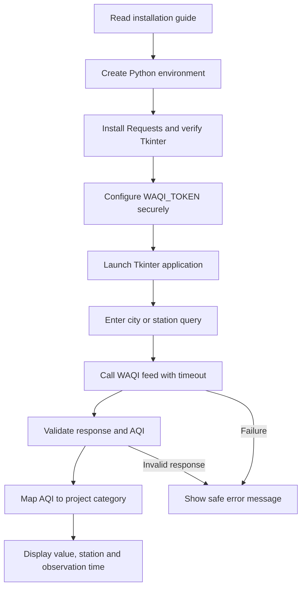

# 📚 AQI Finder documentation

This directory contains project-specific guides for the AQI Finder desktop application. The documentation describes the tracked implementation: a Python/Tkinter desktop UI that requests AQI information from the WAQI feed, validates the response, applies the project's six-category mapping, and displays the result. It distinguishes that working scope from features that are not present, such as a database, server API, user accounts, automatic location detection, or historical trend engine.

## 🧭 Start here

| Goal | Guide |
|---|---|
| Understand product scope and assumptions | [Project overview](project-overview.md) |
| Understand module boundaries and runtime flow | [Architecture](architecture.md) |
| Configure and understand WAQI requests | [API integration](api.md) |
| Install Python, Tkinter, and Requests | [Installation](installation.md) |
| Understand AQI labels and interpretation limits | [AQI methodology](aqi-methodology.md) |
| Test classification and provider failures | [Testing](testing.md) |
| Review the UI and accessibility requirements | [Desktop UI](ui-and-accessibility.md) |
| Package and distribute the desktop application | [Deployment](deployment.md) |
| Understand why no database is used | [Database and persistence](database.md) |
| Diagnose local setup and provider problems | [Troubleshooting](troubleshooting.md) |
| Review current gaps and planned improvements | [Limitations and future scope](limitations-and-future-scope.md) |
| Review design decisions | [Decision records](decisions/README.md) |
| Reuse a test-plan template | [Test-plan template](templates/test-plan-template.md) |
| Reuse an incident report template | [Incident template](templates/incident-report-template.md) |

## 🧭 Application lifecycle

## Documentation maintenance rules

1. Keep statements aligned with the source code and actual provider behaviour.
2. Distinguish the project's configured AQI labels from other national AQI systems.
3. Never include a real API token, private location history, or sensitive screenshots.
4. Treat sample responses and readings as synthetic unless their source and timestamp are documented.
5. Keep Mermaid diagrams in source form so contributors can update them.
6. Add test evidence when documenting a behaviour as validated.
7. Update this index and the root README whenever a guide is added or renamed.

## Security reminder

The original version had a provider token embedded in source code. A token committed to a public repository must be considered compromised and rotated with WAQI. The current source reads `WAQI_TOKEN` from the process environment. See the root [Security policy](../SECURITY.md).

## Repository policies and maintenance

- [Contribution guide](../CONTRIBUTING.md): development and review workflow.
- [Security policy](../SECURITY.md): token handling and vulnerability reports.
- [Governance](../GOVERNANCE.md): project decision principles.
- [Accessibility statement](../ACCESSIBILITY.md): desktop UI accessibility expectations.
- [Release process](../RELEASE.md): release readiness and rollback.
- [Maintainers](../MAINTAINERS.md): stewardship responsibilities.
