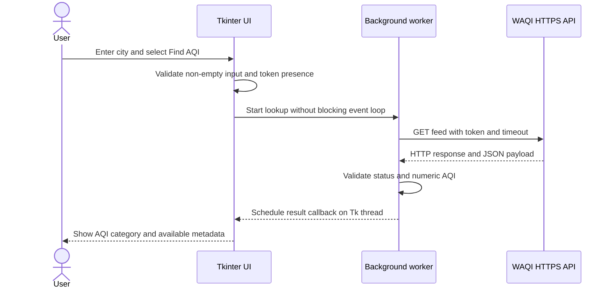

# 🌐 WAQI API integration

## 1. Current integration

The desktop application sends a city or station query to the World Air Quality Index feed using HTTPS:

```text
GET https://api.waqi.info/feed/{city-or-station}/?token={WAQI_TOKEN}
Accept: application/json
Timeout: 12 seconds
```

The token is read from the `WAQI_TOKEN` process environment variable. It must not be embedded in source code, committed to Git, or printed to logs. Any token previously committed publicly should be revoked or rotated with the provider.

## 2. Expected response shape

The current code expects a JSON object with a top-level `status` field. A successful response must have `status = "ok"` and a `data` object containing a non-negative numeric `aqi` value. Optional metadata is read from `data.city.name` and `data.time.s` when those fields are present.

Illustrative response shape only:

```json
{
  "status": "ok",
  "data": {
    "aqi": 42,
    "city": { "name": "Example monitoring station" },
    "time": { "s": "2026-01-01 10:00:00" }
  }
}
```

The numbers and station shown above are synthetic examples. They are not a live reading.

## 3. Request lifecycle



The network call runs in a worker thread so that a slow provider response does not block the Tkinter event loop. UI updates are scheduled back onto the Tk thread.

## 4. Failure handling

| Failure | Application behaviour |
|---|---|
| Empty query | Ask the user to enter a location |
| Missing token | Explain that `WAQI_TOKEN` must be configured |
| Timeout | Show a retry-later message |
| Network or HTTP error | Show a generic provider connectivity message |
| Invalid JSON | Report an unreadable provider response |
| Provider status not `ok` | Report that data is unavailable or query is unsupported |
| Missing or invalid AQI | Reject the payload rather than inventing a value |

The application intentionally avoids displaying raw exception text or full request URLs, which could expose implementation details or credentials.

## 5. Provider responsibilities and attribution

Provider availability, token policy, quotas, permitted use, attribution requirements, station coverage, and field definitions are controlled by WAQI and may change. Review the provider's current official documentation and terms before distribution or commercial use. Do not assume every city string resolves to a single official city-wide measurement. The response may represent a monitoring station.

## 6. Data interpretation

The current implementation applies the six breakpoints that existed in the original application. AQI definitions and category labels vary by country and index system. This local mapping is not a universal regulatory standard. A future release should identify the index method and jurisdiction explicitly before expanding health messaging.

## 7. No other backend services

The repository has no server-side API, database, authentication service, or cache. The desktop application calls WAQI directly from the user's machine. The provider token is therefore present in the outgoing request and should be scoped and managed according to provider options. A server proxy would introduce hosting, privacy, security, and operational obligations and is not part of the current project.
