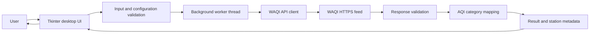
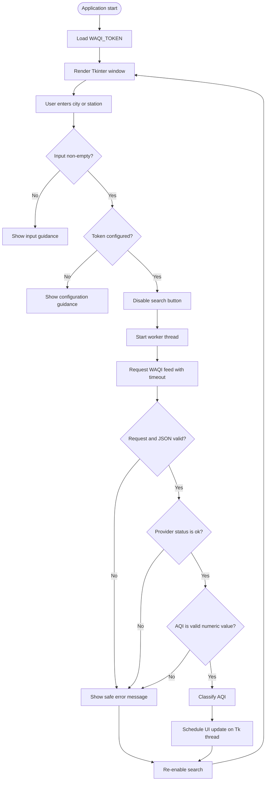

# 🏛️ Application architecture

## 1. System boundary

AQI Finder is a local Python desktop program. It uses Tkinter for the interface and Requests for the WAQI HTTPS request. There is no application server, database, background scheduler, or local search history in the tracked implementation.

## 2. Current component diagram

## 3. Responsibilities

| Component | Responsibility | Important rule |
|---|---|---|
| Tkinter UI | Read input and display status/result | All widget updates run on the Tk main thread |
| Configuration | Load `WAQI_TOKEN` from environment | Never embed or log a real token |
| Network client | Build WAQI request and apply timeout | Use HTTPS and handle request failures |
| Response validator | Validate JSON, status, and AQI value | Reject missing, malformed, negative, or boolean values |
| AQI classifier | Map numeric values to the project's six categories | Keep thresholds separately unit-tested |
| Presentation | Show category and optional station/time | Do not present missing metadata as known facts |

## 4. Runtime flow

## 5. Threading model

Tkinter's event loop must remain responsive. The HTTP request is executed by a daemon worker thread. The worker must not directly mutate widgets. It uses `root.after` to schedule a result or error callback on the Tk thread. A timeout bounds the waiting period, although DNS resolution and platform shutdown behaviour should still be considered during operational testing.

## 6. AQI classification

The project retains the original thresholds:

| Range | Label |
|---:|---|
| 0–50 | Good |
| 51–100 | Moderate |
| 101–150 | Unhealthy for Sensitive Groups |
| 151–200 | Unhealthy |
| 201–300 | Very Unhealthy |
| Above 300 | Hazardous |

The function accepts non-negative numeric values. These project labels should not be assumed equivalent to every national or international AQI standard. Index method and jurisdiction must be stated in any public interpretation.

## 7. Data and persistence

The application displays the fetched AQI, optional station name, optional observation timestamp, and provider attribution. It does not currently persist results or construct location histories. No database is required for the current feature set.

## 8. Extension boundaries

Potential future modules can separate provider adapters, index-specific classification tables, caching, export, or visualization. Add them only with a clear requirement and tests. A server-side service would require explicit decisions about credential storage, privacy, rate limits, availability, observability, and retention. It is not implied by the current desktop architecture.
